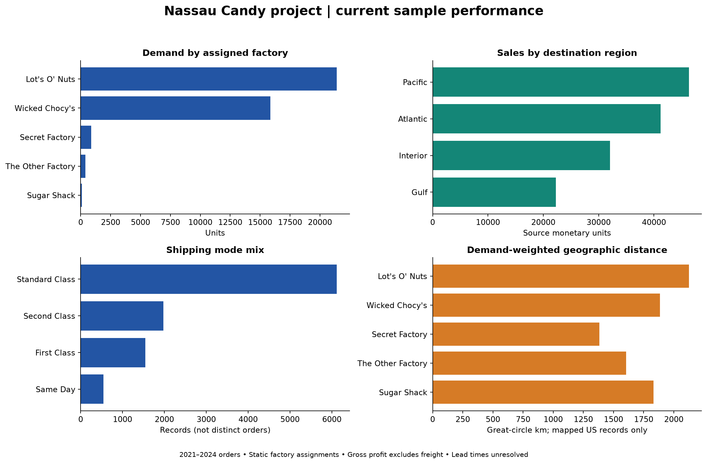
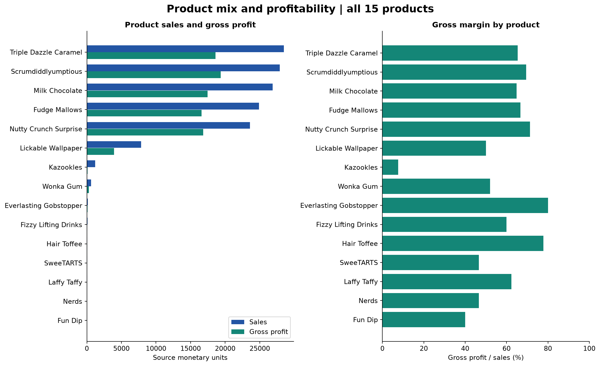
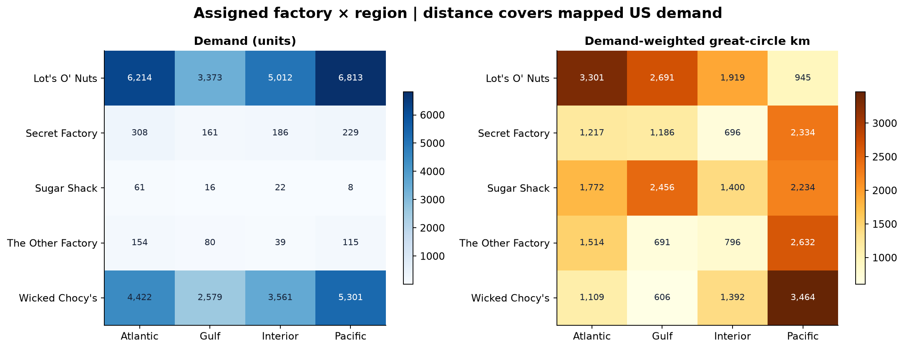
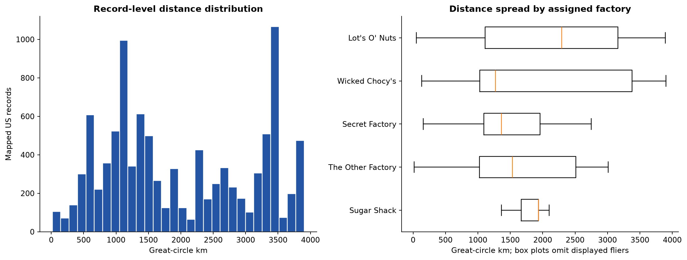
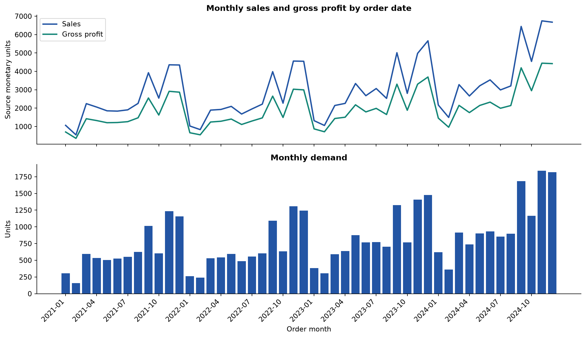
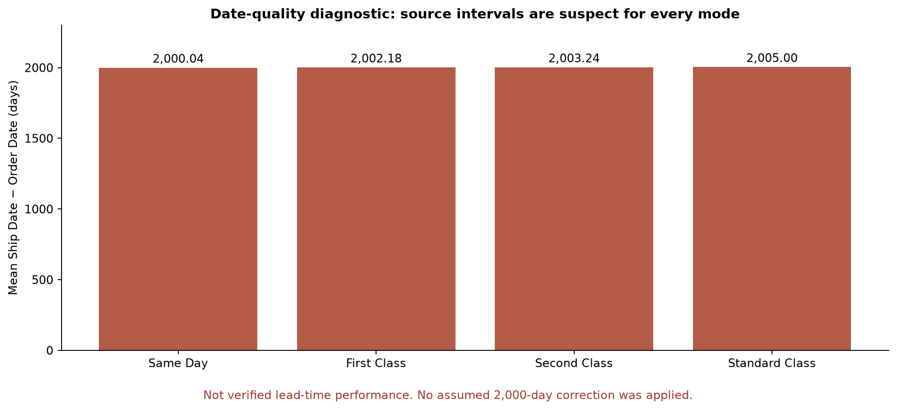

# Current performance analysis

Order-date sample: 2021-01-03 to 2024-12-30. Analysis uses the full cleaned dataset.

## Findings

The sample contains 10,194 records, 38,654 units, sales of 141,783.63, and gross profit of 93,442.80 in source monetary units. Aggregate gross margin is 65.91%. Gross profit excludes shipping and reassignment costs.

Chocolate contributes 96.43% of demand and 92.88% of sales. Prioritizing this division for further geographic analysis covers most of the sample's demand.

Lot's O' Nuts accounts for 21,412 units and 76,340.15 sales. These totals reflect the static product assignment table, not observed factory output or capacity utilization.

Pacific is the largest sales region: 46,301.53, or 32.66% of sample sales. Wonka Bar - Triple Dazzle Caramel has the highest product sales at 28,485.00.

Kazookles has the lowest observed gross margin (7.69%). Any future reassignment scenario needs careful cost sensitivity; no freight expense or feasible reassignment has yet been established.

US ZIP coordinates cover 98.04% of records and 97.98% of units. Mean mapped distance is 1,998.1 km; unit-weighted distance is 2,003.8 km. All 200 Canadian records remain in financial and demand totals but are excluded from distance calculations.

Sample sales increased from 28,953.55 in 2021 to 46,968.11 in 2024 (62.22% across those calendar-year samples). This is descriptive; it does not establish cause or completeness of source business coverage.

There are 0 valid historical lead-time records. The 2,000–2,011-day source intervals are reported only as date-quality diagnostics. Mode labels and relative intervals do not justify measured shipping-service rankings or speed gains.

## Lead times and geographic interpretation

Every product, factory, region, and ship-mode summary includes suspect-interval counts, diagnostic interval statistics, and valid historical counts. Verified mean lead time is blank when no valid historical records exist. A blank is unavailable, not zero days. No delivery-time, on-time-rate, congestion or causal factory-speed claim can be calculated from these dates.

Distance exposure equals the sum of units × great-circle distance over mapped records. It is a geographic review proxy, not vehicle kilometres, transport work, cost or emissions. Routes with at least 30 mapped records are listed as geographic review candidates; this threshold is an explicit sample-support screen, not proof of operational feasibility. No alternative factories or savings are recommended at this EDA stage.

## Product performance

| Product Name | Records | Units | Sales | Gross Profit | Gross Margin Pct |
| --- | --- | --- | --- | --- | --- |
| Wonka Bar - Triple Dazzle Caramel | 2,015 | 7,596 | 28,485.00 | 18,610.20 | 65.33 |
| Wonka Bar - Scrumdiddlyumptious | 2,064 | 7,743 | 27,874.80 | 19,357.50 | 69.44 |
| Wonka Bar - Milk Chocolate | 2,137 | 8,267 | 26,867.75 | 17,443.37 | 64.92 |
| Wonka Bar - Fudge Mallows | 1,818 | 6,914 | 24,890.40 | 16,593.60 | 66.67 |
| Wonka Bar - Nutty Crunch Surprise | 1,810 | 6,755 | 23,574.95 | 16,819.95 | 71.35 |
| Lickable Wallpaper | 94 | 393 | 7,860.00 | 3,930.00 | 50.00 |
| Kazookles | 96 | 371 | 1,205.75 | 92.75 | 7.69 |
| Wonka Gum | 120 | 478 | 597.50 | 310.70 | 52.00 |
| Everlasting Gobstopper | 3 | 13 | 130.00 | 104.00 | 80.00 |
| Fizzy Lifting Drinks | 6 | 21 | 78.75 | 47.25 | 60.00 |
| Hair Toffee | 4 | 17 | 76.50 | 59.50 | 77.78 |
| SweeTARTS | 10 | 41 | 61.50 | 28.70 | 46.67 |
| Laffy Taffy | 10 | 27 | 53.73 | 33.48 | 62.31 |
| Nerds | 4 | 10 | 15.00 | 7.00 | 46.67 |
| Fun Dip | 3 | 8 | 12.00 | 4.80 | 40.00 |

## Assigned factory performance

| Assigned Factory | Records | Units | Sales | Gross Profit | Unit Weighted Great Circle Km |
| --- | --- | --- | --- | --- | --- |
| Lot's O' Nuts | 5,692 | 21,412 | 76,340.15 | 52,771.05 | 2,124.69 |
| Wicked Chocy's | 4,152 | 15,863 | 55,352.75 | 36,053.57 | 1,885.94 |
| Secret Factory | 217 | 884 | 8,587.50 | 4,344.70 | 1,382.11 |
| The Other Factory | 100 | 388 | 1,282.25 | 152.25 | 1,603.68 |
| Sugar Shack | 33 | 107 | 220.98 | 121.23 | 1,832.26 |

## Regional performance

| Region | Units | Sales | Gross Profit | Gross Margin Pct | Unit Weighted Great Circle Km |
| --- | --- | --- | --- | --- | --- |
| Pacific | 12,466 | 46,301.53 | 30,485.94 | 65.84 | 2,062.60 |
| Atlantic | 11,159 | 41,197.24 | 26,973.70 | 65.47 | 2,350.70 |
| Interior | 8,820 | 32,037.60 | 21,282.49 | 66.43 | 1,674.83 |
| Gulf | 6,209 | 22,247.26 | 14,700.67 | 66.08 | 1,759.75 |

## Shipping modes

| Ship Mode | Records | Units | Sales | Gross Profit | Valid Historical Lead Time Records |
| --- | --- | --- | --- | --- | --- |
| Standard Class | 6,120 | 23,409 | 85,490.35 | 56,424.46 | 0 |
| Second Class | 1,979 | 7,546 | 27,860.22 | 18,306.52 | 0 |
| First Class | 1,548 | 5,724 | 21,319.39 | 14,011.09 | 0 |
| Same Day | 547 | 1,975 | 7,113.67 | 4,700.73 | 0 |

## Geographic review candidates

| Assigned Factory | Region | Mapped Records | Mapped Units | Unit Weighted Great Circle Km | Distance Exposure Unit Km |
| --- | --- | --- | --- | --- | --- |
| Lot's O' Nuts | Atlantic | 1,593 | 5,954 | 3,300.85 | 19,653,235.39 |
| Wicked Chocy's | Pacific | 1,328 | 5,238 | 3,464.23 | 18,145,631.14 |
| Lot's O' Nuts | Interior | 1,319 | 5,007 | 1,918.78 | 9,607,307.20 |
| Lot's O' Nuts | Gulf | 897 | 3,373 | 2,691.36 | 9,077,951.18 |
| Lot's O' Nuts | Pacific | 1,779 | 6,685 | 945.44 | 6,320,298.26 |

## Yearly performance

| Year | Records | Units | Sales | Gross Profit | Gross Margin Pct |
| --- | --- | --- | --- | --- | --- |
| 2,021 | 2,051 | 7,813 | 28,953.55 | 18,942.37 | 65.42 |
| 2,022 | 2,130 | 8,086 | 29,002.65 | 19,209.06 | 66.23 |
| 2,023 | 2,634 | 10,018 | 36,859.32 | 24,340.58 | 66.04 |
| 2,024 | 3,379 | 12,737 | 46,968.11 | 30,950.79 | 65.90 |

## Outlier sensitivity

| Metric | Primary Total | Outlier Filtered Total | Difference | Change Pct |
| --- | --- | --- | --- | --- |
| Sales | 141,783.63 | 141,531.63 | -252.00 | -0.18 |
| Gross Profit | 93,442.80 | 93,267.80 | -175.00 | -0.19 |
| Cost | 48,340.83 | 48,263.83 | -77.00 | -0.16 |
| Units | 38,654.00 | 38,584.00 | -70.00 | -0.18 |

## Charts

## Method and reproducibility

Demand is measured in units; Records counts rows, while Distinct Source Order IDs counts unique IDs within each group. Do not sum group-specific distinct-ID counts to recover the overall count. Shares use the full sample denominator. Margins are ratios of total gross profit to total sales, not averages of record percentages. Distance means and percentiles use available US coordinates only; unit-weighted means weight each mapped record by units. Monetary amounts are source units, with currency unspecified. Sparse product groups are retained and identified, not extrapolated into confident operational recommendations.

The five cost-outlier records remain in primary totals. The optional sensitivity table shows the effect of excluding them; it is not the default business population. Geographic exposure and static factory assignments cannot measure factory congestion or capacity.

Reproduce with `python -m pip install -r analysis/requirements-eda.txt`, then `python analysis/explore_performance.py`. Summary CSVs are in `reports/eda/tables/`; exact machine-readable metrics and library versions are in `reports/eda/performance_metrics.json`. The preparation and cleaning scripts should be run first if source inputs change. See [the dataset guide](../../datasets/DATASET_GUIDE.md) and [cleaning report](../data_cleaning_report.md) for source attribution and quality rules.
