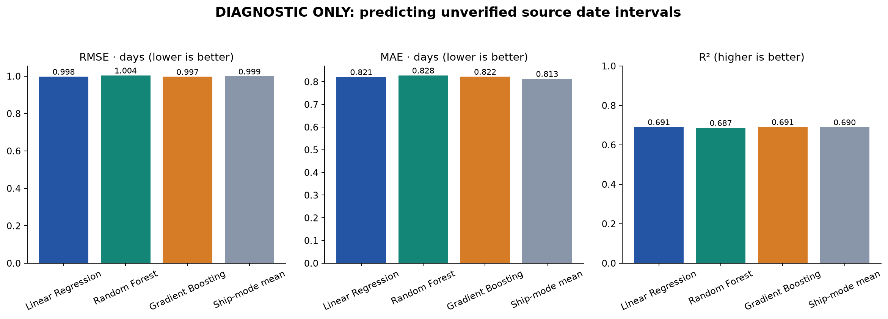

# Prediction model comparison — diagnostic

**Diagnostic only. All source date intervals are suspect. These metrics compare fit to unverified date differences; they do not establish actual lead-time accuracy or shipping improvements. No operational model was created.**

## Features and preprocessing

Target: `Order To Shipment Lead Time Days`, computed from the unchanged source dates. No assumed 2,000-day correction was applied. Valid historical target records: 0.

Numerical features: Units, great-circle distance, order month and order weekday. Categorical features: Product ID, assigned factory, destination region and ship mode. Numerical missing values are median-imputed with a missing indicator and standardized; categories are most-frequent-imputed and one-hot-encoded, with unknown categories ignored. Imputation and encoding apply only inside the model pipeline, not to source geography.

The pipeline excludes shipment dates, target-derived quality flags, customer/row/order identifiers, financial outcomes and globally computed EDA outlier flags. Product ID is the stable product category. Assigned factory is the static reference origin, not an observed shipment origin.

## Chronological evaluation

| Partition | Records | Start | End |
|---|---:|---|---|
| Initial training | 6,519 | 2021-01-03 | 2023-12-04 |
| Validation | 1,632 | 2023-12-05 | 2024-07-17 |
| Untouched test | 2,043 | 2024-07-18 | 2024-12-30 |

The first split approximates 80% development / 20% test by record count, keeping whole dates together. Development is split again approximately 80% / 20% into initial training and validation. No order date or repeated source Order ID crosses partitions. Initial preprocessing fits only initial training; final preprocessing fits only pretest development after selection.

Training-only 3-IQR screens for quantity within product and target interval within ship mode exclude 0 records for validation fits and 0 records for final pretest fits. Groups below 20 records or with zero IQR are not trimmed. All validation and test records are evaluated without trimming; the global cleaned-data outlier flags never drive model filtering. Thresholds and exclusions are exported.

All models use fixed parameters and seed 42. Random Forest: 160 trees, maximum depth 10, minimum leaf size 4. Gradient Boosting: 160 trees, learning rate 0.05, maximum depth 2, minimum leaf size 4. Linear Regression uses ordinary least squares. Hyperparameters were not tuned on the test set.

## Metrics

RMSE penalizes larger errors; MAE averages absolute errors; R² measures explained variance relative to the holdout mean. All errors are in days of the unverified source interval.

| Model | Evaluation | RMSE Days | MAE Days | R2 |
| --- | --- | --- | --- | --- |
| Linear Regression | Chronological validation | 1.0307 | 0.8463 | 0.6683 |
| Random Forest | Chronological validation | 1.0529 | 0.8692 | 0.6538 |
| Gradient Boosting | Chronological validation | 1.0343 | 0.8529 | 0.6659 |
| Linear Regression | Untouched chronological test | 0.9976 | 0.8210 | 0.6907 |
| Random Forest | Untouched chronological test | 1.0042 | 0.8281 | 0.6866 |
| Gradient Boosting | Untouched chronological test | 0.9966 | 0.8224 | 0.6912 |
| Training ship-mode mean (sanity baseline) | Untouched chronological test | 0.9987 | 0.8132 | 0.6900 |

Selected diagnostic model: **Linear Regression**, chosen before inspecting test scores using validation RMSE and a documented interpretability tie rule: within 5% of the lowest validation RMSE, prefer Linear Regression, then Gradient Boosting, then Random Forest. The 5% tolerance is an explicit project heuristic. Final models are refitted on pretest development and then evaluated once on the untouched test. The training ship-mode mean is an additional sanity baseline, not a fourth requested model or a selection candidate.

Selected model's test RMSE: 0.9976 days; MAE: 0.8210 days; R²: 0.6907. High R² would still only reflect the unverified target pattern.

The requested models' test RMSE values are close to the simple training ship-mode mean. More complex models therefore provide little improvement in this comparison. Permutation importance highlights ship mode as the dominant predictive feature; independent factory effects remain unsupported.



## Interpretability

| Model | Interpretability |
| --- | --- |
| Linear Regression | Additive coefficients; numerical coefficients are per standardized feature unit. Product/factory collinearity prevents independent factory attribution. |
| Random Forest | Nonlinear tree ensemble. Training impurity importance describes association and can favor high-cardinality inputs; it is not causal. |
| Gradient Boosting | Additive ensemble of shallow trees. More complex than linear regression; feature importance describes learned association, not factory effects. |

Encoded coefficients or impurity importances are exported for all three models. Selected-model raw-feature permutation importance measures increased MAE after shuffling a feature, using five repeats on a reproducible sample of up to 600 test records. It is explanatory reporting after selection and does not tune or select the model. Correlated product and factory features can share or mask importance, so coefficients and permutation values cannot identify independent factory effects.

| Feature | Mean MAE Increase Days | Repeat Standard Deviation |
| --- | --- | --- |
| Ship Mode | 0.9842 | 0.0254 |
| Great Circle Distance Km | 0.0077 | 0.0017 |
| Assigned Factory | 0.0042 | 0.0015 |
| Region | 0.0014 | 0.0008 |
| Order Weekday | 0.0003 | 0.0003 |
| Units | 0.0000 | 0.0000 |
| Order Month | -0.0000 | 0.0007 |
| Product ID | -0.0008 | 0.0012 |

## Limits and deployment status

Each product appears at only one factory in the source assignment table. Changing its factory at inference creates an unsupported combination; held-out accuracy does not validate reallocation effects. Sparse products also limit coverage. Features such as ship mode may explain the diagnostic target pattern without demonstrating congestion, delivery speed or actual logistics costs.

Diagnostic bundles are saved only in `models/diagnostic/` and explicitly marked `operational_use_allowed=false`. There is no production model or recommendation engine. Normal-mode training refuses this dataset until source-date quality is resolved. The observed intervals remain unchanged; no synthetic targets were created.

## Reproduce and inspect

```powershell
python -m pip install -r analysis/requirements-models.txt
python analysis/train_compare_models.py --diagnostic
```

The default command without `--diagnostic` writes a readiness report and exits with code 2 when date quality fails. Split assignments, training-only thresholds, exact test predictions, preprocessing statistics, metrics, interpretation tables, and the selected model's actual transformed training matrix are saved beside this report. Library versions are recorded in `comparison_summary.json`; joblib bundles should be loaded only from trusted sources with compatible dependency versions.
