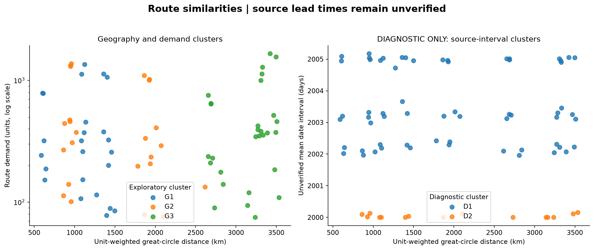
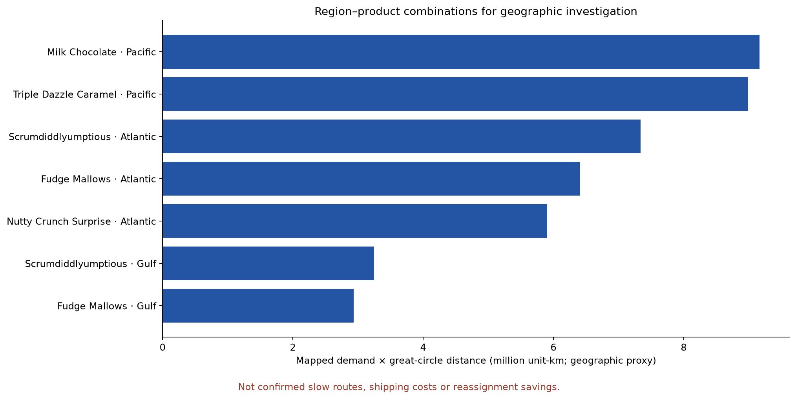
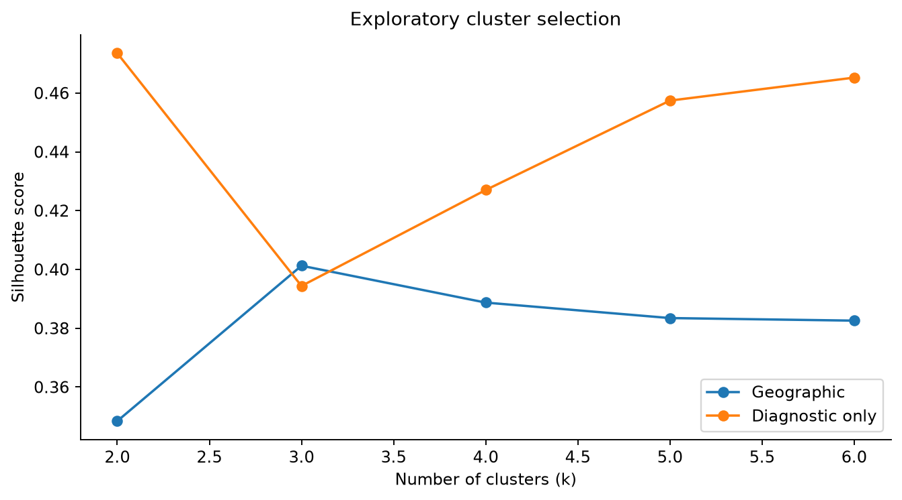

# Route clustering and investigation priorities

**Current data does not support confirmed slow-route or congestion claims. All source lead-time intervals are suspect. Geographic review candidates are identified below; four-feature lead-time clustering is explicitly diagnostic only.**

## Scope and population

A route is one Product ID × assigned factory × destination country × region × ship mode combination. Factory means the static product assignment, not an observed shipment origin. Country is retained to distinguish unavailable Canadian geography from mapped US ZIP centroids.

There are 180 routes. 77 have at least 20 records and 90% coordinate coverage and are clustered, covering 9,623 of 10,194 records. 26 routes lack coordinates. 101 routes have fewer than 20 records; these categories can overlap. Unassigned routes remain in the summaries and investigation exports. No records are dropped from financial or demand totals.

## Features and method

The geographic cluster set uses unit-weighted great-circle distance, within-route distance standard deviation, and log(1 + demand units). The diagnostic set uses unit-weighted distance, mean unchanged Ship Date minus Order Date, standard deviation of that interval, and log(1 + demand units), satisfying the requested four-feature comparison without claiming verified time performance.

StandardScaler fits the selected routes, followed by KMeans with seed 42 and 20 initializations. Routes are weighted equally in clustering; demand enters as a log-transformed feature. Candidate k values 2–6 are compared with silhouette score, rejecting solutions with fewer than three routes in any cluster. These are explicit exploratory support rules, not service targets. Clusters are numbered by increasing mean geographic distance; numbers are not performance ranks.

Geographic selection: k=3, silhouette=0.401. Diagnostic selection: k=2, silhouette=0.474. Additional seeds 7, 101 and 2026 are compared with adjusted Rand index; this checks initialization sensitivity, not temporal generalization or proof of business outcomes.

| Cluster Set | Cluster | Routes | Units | Mean Route Distance Km | Mean Distance Std Km | Median Route Units |
| --- | --- | --- | --- | --- | --- | --- |
| Geographic | G1 | 24 | 10341 | 1,106.38 | 206.87 | 290.50 |
| Geographic | G2 | 24 | 11768 | 1,464.57 | 500.24 | 322.00 |
| Geographic | G3 | 29 | 14323 | 3,154.68 | 365.69 | 370.00 |
| Diagnostic only | D1 | 62 | 34823 | 1,970.44 | 353.95 | 377.00 |
| Diagnostic only | D2 | 15 | 1609 | 2,068.08 | 375.39 | 101.00 |

## Region–product combinations requiring investigation

Candidates have at least 30 mapped records, at least 90% coordinate coverage, and demand-weighted distance at or above the upper quartile of supported region–product combinations (2,697.4 km). They are ranked by mapped units × great-circle distance. This geographic exposure proxy is not a transport-cost or emissions metric.

7 combinations meet the screen. 5 also show persistent long geographic distances: at least three quarters with five mapped records each, with distance at or above the same threshold in at least 75% of those quarters. This describes geography, not consistently slow shipping.

| Product Name | Assigned Factory | Region | Mapped Units | Unit Weighted Distance Km | Supported Geographic Quarters | Long Distance Quarter Share Pct |
| --- | --- | --- | --- | --- | --- | --- |
| Wonka Bar - Milk Chocolate | Wicked Chocy's | Pacific | 2659 | 3,446.84 | 16.00 | 100.00 |
| Wonka Bar - Triple Dazzle Caramel | Wicked Chocy's | Pacific | 2579 | 3,482.16 | 16.00 | 100.00 |
| Wonka Bar - Scrumdiddlyumptious | Lot's O' Nuts | Atlantic | 2224 | 3,299.86 | 16.00 | 100.00 |
| Wonka Bar - Fudge Mallows | Lot's O' Nuts | Atlantic | 1936 | 3,309.82 | 16.00 | 100.00 |
| Wonka Bar - Nutty Crunch Surprise | Lot's O' Nuts | Atlantic | 1794 | 3,292.39 | 16.00 | 100.00 |
| Wonka Bar - Scrumdiddlyumptious | Lot's O' Nuts | Gulf | 1203 | 2,697.39 | 15.00 | 46.67 |
| Wonka Bar - Fudge Mallows | Lot's O' Nuts | Gulf | 1082 | 2,711.75 | 15.00 | 66.67 |

Investigate freight rates, actual shipment origins, production compatibility, capacity and order-to-shipment dates for these flows. Clusters do not establish that changing factories is feasible or profitable. Sparse routes require additional observations; all Canadian routes require destination coordinates before geographic comparison.

## Consistently slow routes: unavailable

Valid historical date-interval records: 0. The confirmed-slow export is currently header-only. Its zero rows mean detection is unavailable, not that no slow routes exist. Raw means, P90 intervals and standard deviations remain diagnostic columns; no 2,000-day offset was subtracted. Delivery times cannot be measured without delivery dates.

The implemented future consistency screen requires at least 20 valid interval records per route-quarter, at least three comparable routes in the same country/ship-mode/quarter, and at least three supported quarters. A route must exceed the peer upper-quartile mean in at least 75% of those quarters and in its latest supported quarter. This would identify relative slowness, not SLA failure or congestion. It cannot run meaningfully on the current source dates.

## Outputs and reproducibility

Run `python analysis/cluster_routes.py` after preparation and cleaning, using the dependencies in `analysis/requirements-models.txt`. Outputs beside this report include route assignments, cluster summaries, silhouette comparisons, seed stability, input matrices, quarterly histories, region–product summaries and priorities, sparse/unmapped routes, and the empty confirmed-slow table. Cluster pipelines are saved in `models/route_clusters/` with explicit exploratory/diagnostic flags.

Source attribution and coordinate limitations are in [the dataset guide](../../datasets/DATASET_GUIDE.md); cleaning decisions are in [the cleaning report](../data_cleaning_report.md). All monetary values use source units. This is exploratory analysis of a public educational sample, not verified operational performance.
