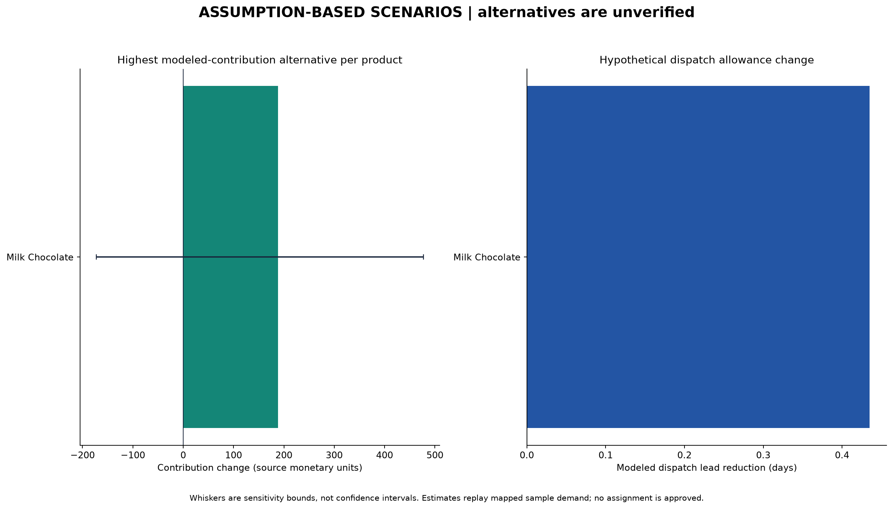

# Factory scenario simulator

**All lead-time and logistics estimates are hypothetical. All alternative product–factory combinations lack historical outcome evidence. No scenario establishes operational feasibility or actual profit/speed improvement.**

The simulator compares 1 products across 5 product–factory scenarios: 1 current assignments and 4 alternatives. It computes 405 sensitivity cases. Filters used: `{"product": "CHO-MIL-31000", "region": "Pacific", "ship_mode": "Standard Class"}`.

## Source and estimate scopes

Historical orders, sales, manufacturing costs, units, product assignments and coordinates remain unchanged. Scenario estimates replay only records with destination coordinates. Source Records/Units and mapped coverage are included for every product. Unmapped Canadian records are not assigned zero distances or assumed financial outcomes. The full hypothetical one-time setup cost is charged to the mapped subset. Values cover the sample replay, not annual savings or a future forecast.

Static Assignment Record Support counts records consistent with the reference product assignment. It does not count observed origin-factory measurements. Observed Factory Origin Records remains zero. Every alternative is explicitly flagged uncertain. Factory capacity, production compatibility and operational feasibility remain unverified.

## Documented assumptions and formulas

All assumptions are in `datasets/simulated/logistics_assumptions.json` and copied into `assumptions_used.json` beside this report. Money uses source monetary units; the source dictionary does not specify currency.

- Planning distance proxy = Haversine great-circle distance × 1.15. This is not measured road distance.
- Logistics per record = (handling allowance 0.04 + units × 0.03 + units × planning distance / 1,000 × 0.06) × ship-mode cost multiplier. Handling is per source record because repeated Order IDs have ambiguous transaction grain.
- Modeled order-to-dispatch allowance = factory preparation days + ship-mode preparation days + planning distance / 1,000 × 0.15 days. The last term is an explicit hypothetical dispatch-coordination buffer before shipment, not vehicle travel or delivery time.
- Current manufacturing cost remains the source cost. Candidate manufacturing cost = source cost × the candidate's alternative manufacturing multiplier; the base default is 1.0 at every factory, a neutral assumption.
- Modeled contribution = sales − manufacturing cost − assumed logistics cost − assumed setup cost. It is not actual net profit; taxes, overheads, inventory effects and other transition costs are absent.
- Setup cost is 100.0 once per alternative product–factory scenario over the cohort replay. Current assignment incurs zero setup cost.

Dispatch averages are weighted by units. Candidate dispatch P90 is record-based. Current and alternative scenarios use identical mapped destination records and the same ship modes/units. Contribution percentage change is unavailable when current modeled contribution is nonpositive.

## Sensitivity

The grid jointly varies distance-rate, alternative-manufacturing, setup-cost and dispatch-buffer multipliers. The axis sizes are [3, 3, 3, 3], giving 81 cases per available scenario. Each grid includes 1.0 so the base case is within the sensitivity bounds. Baseline and candidate share the distance-rate and dispatch-buffer perturbations; manufacturing perturbations and setup costs apply only to alternatives. The minimum and maximum changes are bounds over the tested assumptions, not probabilities or statistical confidence intervals.

Base-case positive-contribution alternatives: 3. Alternatives with shorter modeled dispatch allowances: 4. Alternatives with nonnegative contribution change in every tested case: 0. These counts describe the chosen assumptions, not real business outcomes. Current-factory scenarios have exactly zero changes under all sensitivity cases.

## Comparison by product

The table shows the alternative with the highest base-case modeled contribution for each product, including products whose best alternative is still worse than the current assignment. This is a descriptive comparison, not a recommendation or feasibility approval. All five options, including current factories, are in `scenarios.csv`.

| Product Name | Current Factory | Candidate Factory | Modeled Dispatch Lead Reduction Days | Modeled Contribution Change | Sensitivity Min Contribution Change | Sensitivity Max Contribution Change |
| --- | --- | --- | --- | --- | --- | --- |
| Wonka Bar - Milk Chocolate | Wicked Chocy's | Lot's O' Nuts | 0.435 | 188.372 | -172.733 | 477.064 |



## Reliability limits

Source Ship Date minus Order Date remains suspect; no 2,000-day correction is applied. The diagnostic regression models are not used for these estimates. Estimated dispatch changes come solely from the hypothetical formula. Alternative factories have no historical product-specific outcomes, and even current shipment origins are inferred from static assignments. No factory-product capability or capacity is invented.

Before implementing an assignment, replace assumptions with verified dates, observed origin/outcome records, tariffs, factory preparation times, manufacturing/reassignment costs and production constraints. Sensitivity consistency is not a confidence score. The simulator does not claim congestion relief, delivery improvement or actual profit preservation.

## Reproduce and use

```powershell
python analysis/scenario_simulator.py
python analysis/scenario_simulator.py --product CHO-MIL-31000 --region Pacific --ship-mode "Standard Class"
```

Optional `--assumptions path/to/file.json` runs an edited assumption file. Filtered runs use a separate subfolder so the full comparison is retained. The pure `simulate()` function returns scenario, sensitivity and route-comparison DataFrames for future dashboard integration. Dependencies are included in `analysis/requirements-models.txt`. Source provenance and geographic limitations are documented in [the dataset guide](../../datasets/DATASET_GUIDE.md).
