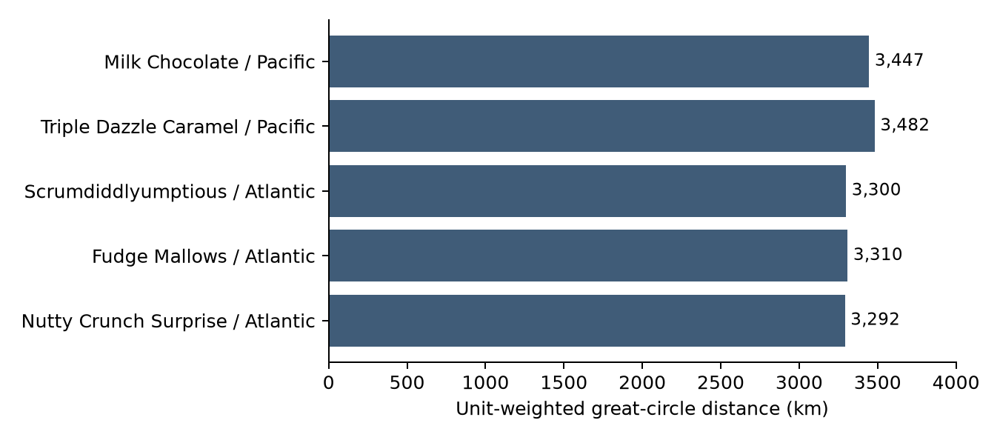
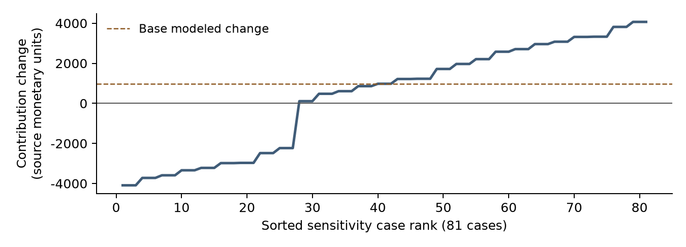

# Factory Reallocation and Shipping Optimization Recommendation System for Nassau Candy Distributor

Research paper | Data analytics internship submission | Analysis snapshot 10 October 2026

## Abstract

This applied study evaluates factory assignments in a public educational candy-distributor sample containing 10,194 records, 38,654 units, 15 products and five factories. Descriptive analysis identifies concentrated chocolate demand and substantial geographic exposure. However, every source order-to-shipment interval is 2,000-2,011 days; the target is unverified and no operational prediction model can be validated. Linear Regression, Random Forest and Gradient Boosting were therefore compared only as diagnostics using chronological splits and preprocessing fitted within training partitions. Linear Regression was selected on validation accuracy and interpretability, with test RMSE 0.9976 days on the anomalous target.

A separate simulator uses explicitly hypothetical dispatch and logistics assumptions. At the default equal speed/profit priority, five chocolate products are proposed for investigation at Secret Factory. The modeled portfolio dispatch reduction is 4.06%, base contribution change is +977.68 source monetary units, and contribution is nonnegative in 66.67% of the 81 tested joint sensitivity cases. Evidence readiness and verified recommendation coverage are both zero. The study supports targeted data collection and geographic review; it does not establish feasible reassignments, delivery improvements or realized profit gains.

## Research purpose

The assignment asks which products should be reassigned to improve shipping performance while protecting profitability. This paper examines three questions: where current demand and geographic exposure concentrate; how well the requested regressors fit the available date intervals; and which alternate assignments deserve investigation under transparent, adjustable assumptions.

## Scope of the evidence

Observed sample financials and source dates, static reference assignments, and simulated outcomes are reported separately. The unit of analysis is a source record, not necessarily a distinct order. Repeated Order IDs are retained because the transaction grain is ambiguous. The sample is not verified proprietary Nassau Candy operating data, and no official company or government endorsement is claimed. [1, 4]

<!-- Page break -->

## Data provenance and validation

The Maven Analytics US Candy Distributor archive supplies the 18 required order fields and reference tables. Its publisher labels the dataset Public Domain. Source bytes are preserved with SHA-256 hashes. Factory coordinates and product assignments supplied in the internship brief are reconciled through documented spelling aliases. US destination coordinates come from the historical SimpleMaps ZIP snapshot packaged in the archive; the Basic geography attribution is retained under CC BY 4.0. Current website summary counts are not substituted for the actual downloaded file counts. [1, 2, 4]

Table 1  Validation results from the cleaning and geography exports

| Validation measure | Result |
| --- | --- |
| Primary cleaned records | 10,194 |
| Missing required cells and exact duplicate removals | 0 and 0 |
| Product names standardized and division labels corrected | 2,064 and 6 |
| Extreme cost records flagged and retained | 5 |
| Source intervals outside the 60 day quality screen | 10,194 |
| Shipment dates after the analysis snapshot | 9,824 |
| Verified historical lead time training records | 0 |
| Mapped records and mapped unit coverage | 9,994 records and 97.98% of units |

Money is checked as finite decimal values, units as positive integers, and gross profit against sales minus manufacturing cost with tolerance 0.01. Identifiers and postal codes remain text. Only exact duplicates are removable; no duplicates or conflicting Row IDs required removal. Six Fizzy Lifting Drinks division labels were corrected to Other. [4]

Outer Tukey fences at three times the interquartile range flag extreme values within relevant product, ship-mode or country groups. Groups below 20 observations or with zero IQR are unassessed. The five flagged cost records are retained in primary EDA, with a separate 10,189-record sensitivity subset. Excluding them changes sales by -0.18% and gross profit by -0.19%, so the reported aggregate concentration is not driven by these five records. [4, 5]

**Date interpretation.** Ship Date minus Order Date measures the interval until shipment. Delivery dates are absent. All intervals fail the explicit 60-day screen; no assumed 2,000-day correction is applied. A systematic shift can evade relative outlier screening, so this quality failure is treated separately. [4]

<!-- Page break -->

## Demand sales and profitability

Orders span 3 January 2021 to 30 December 2024. Across the full cleaned population, sales total 141,783.63, manufacturing cost 48,340.83 and source gross profit 93,442.80, in unspecified source monetary units. Gross margin is 65.91%. These source profits exclude freight, reassignment expense and other operating costs. Chocolate represents 96.43% of units and 92.88% of sales, making its five products the largest-demand scope for further investigation. [5]

Table 2  Source financials by static assigned factory  Monetary columns use source units

| Assigned factory | Units | Sales | Gross profit | Margin |
| --- | --- | --- | --- | --- |
| Lot's O' Nuts | 21,412 | 76,340.15 | 52,771.05 | 69.13% |
| Wicked Chocy's | 15,863 | 55,352.75 | 36,053.57 | 65.13% |
| Secret Factory | 884 | 8,587.50 | 4,344.70 | 50.59% |
| The Other Factory | 388 | 1,282.25 | 152.25 | 11.87% |
| Sugar Shack | 107 | 220.98 | 121.23 | 54.86% |

Lot's O' Nuts accounts for 55.39% of units and Wicked Chocy's for 41.04%. Together, their chocolate assignments dominate the sample. These totals are reference-based allocations, not measurements of factory production or capacity utilization. Secret Factory has 884 statically assigned units in the sample; its current support should not be interpreted as spare production capacity. [5]

Table 3  Demand and sales by destination region

| Destination region | Units | Sales | Sales share |
| --- | --- | --- | --- |
| Pacific | 12,466 | 46,301.53 | 32.66% |
| Atlantic | 11,159 | 41,197.24 | 29.06% |
| Interior | 8,820 | 32,037.60 | 22.60% |
| Gulf | 6,209 | 22,247.26 | 15.69% |

Pacific is the largest sales region at 32.66%, followed by Atlantic at 29.06%. Sample annual sales rise from 28,953.55 in 2021 to 46,968.11 in 2024, a descriptive increase of 62.22%. Completeness and comparability of the business sample are not established, so this is not a causal growth estimate. Kazookles has the lowest product gross margin, 7.69%, reinforcing the need to evaluate transition costs before considering a low-margin product move. [5]

<!-- Page break -->

## Shipping modes geography and route investigation

Table 4  Mode labels describe demand allocation  They do not verify service speed

| Ship mode | Records | Units | Demand share |
| --- | --- | --- | --- |
| Standard Class | 6,120 | 23,409 | 60.56% |
| Second Class | 1,979 | 7,546 | 19.52% |
| First Class | 1,548 | 5,724 | 14.81% |
| Same Day | 547 | 1,975 | 5.11% |

Standard Class carries 60.56% of units. No mode has validated historical lead-time observations. Haversine great-circle distances use static factory coordinates and destination ZIP centroids. Coordinates cover 98.04% of records; all 200 Canadian records remain in source financial totals but are excluded from geographic scenarios. The mapped unit-weighted distance is 2,003.8 km. These distances are not actual road routes, transport costs or emissions. [5, 6]

Routes are product by assigned factory by destination country by region by ship mode. Of 180 routes, 77 meet at least 20-record support and 90% coordinate coverage, covering 9,623 records. Geographic KMeans uses standardized distance, within-route distance variability and log-transformed demand; three clusters have silhouette 0.401. A separate four-feature diagnostic adds the unverified mean and standard deviation of date intervals, selecting two clusters with silhouette 0.474. Candidate cluster counts 2-6, seed 42 and 20 initializations are documented. Additional tested seeds reproduce the assignments, which checks initialization stability rather than business validity. [6]

Seven combinations meet the geographic screen; five are persistently distant. Investigate the two Pacific and three Atlantic flows in Figure 1 first. The two Gulf candidates are less persistent. Confirmed slow-route detection is unavailable; the empty export does not prove that slow routes are absent. Congestion cannot be established from these data. [6]

<!-- Page break -->

## Prediction models and chronological evaluation

The unchanged source date interval is the diagnostic target. Numerical features are units, great-circle distance, order month and weekday. Categorical features are Product ID, assigned factory, region and ship mode. Median imputation with a missing indicator and numerical standardization, plus most-frequent categorical imputation and one-hot encoding, are fitted inside training pipelines. Source geography is never filled with a zero distance. Target-derived fields, shipment dates, IDs and financial outcomes are excluded. [3, 7]

Table 5  Whole dates and repeated Order IDs stay within a single partition

| Partition | Records | Order date range |
| --- | --- | --- |
| Initial training | 6,519 | 2021-01-03 to 2023-12-04 |
| Validation | 1,632 | 2023-12-05 to 2024-07-17 |
| Untouched test | 2,043 | 2024-07-18 to 2024-12-30 |

Training-only three-IQR quantity and interval screens exclude zero records. Validation and test records are untrimmed. Final preprocessing fits only pretest development after selection. Linear Regression uses ordinary least squares. Random Forest has 160 trees, depth 10 and minimum leaf size 4. Gradient Boosting has 160 trees, learning rate 0.05, depth 2 and minimum leaf size 4. Seeds are fixed at 42; test results do not tune parameters. [7]

Table 6  Diagnostic fit to anomalous date intervals  Errors are not verified shipping errors

| Model and evaluation | RMSE days | MAE days | R2 |
| --- | --- | --- | --- |
| Linear Regression / validation | 1.0307 | 0.8463 | 0.6683 |
| Random Forest / validation | 1.0529 | 0.8692 | 0.6538 |
| Gradient Boosting / validation | 1.0343 | 0.8529 | 0.6659 |
| Linear Regression / test | 0.9976 | 0.8210 | 0.6907 |
| Random Forest / test | 1.0042 | 0.8281 | 0.6866 |
| Gradient Boosting / test | 0.9966 | 0.8224 | 0.6912 |
| Ship mode mean baseline / test | 0.9987 | 0.8132 | 0.6900 |

RMSE penalizes larger errors, MAE reports average absolute error, and R2 compares explained variance with a holdout mean baseline. Linear Regression is selected on validation RMSE and a predefined interpretability rule favoring it within 5% of the best validation RMSE. It is then refitted on pretest development. Gradient Boosting has marginally lower test RMSE, but this does not justify selecting it after viewing the test. The simple training ship-mode mean has similar RMSE and lower MAE than the requested models. [3, 7]

<!-- Page break -->

## Interpretability and the scenario design

Raw-feature permutation importance for the selected diagnostic model shows ship mode increasing MAE by 0.9842 days when shuffled, versus 0.0077 days for distance and 0.0042 days for assigned factory. These values describe association with the suspect target. Product and factory are coupled because each product has only one static assigned factory. Linear coefficients cannot identify independent factory effects, and nonlinear tree models cannot validate an unseen alternate factory-product combination from this assignment structure. No diagnostic model is used in the operational simulator. [7]

### Explicit hypothetical assumptions

The simulator compares 75 product-factory scenarios: 15 current assignments and 60 alternatives. It replays identical mapped destination records, units and ship modes for each pair. Planning distance is 1.15 times Haversine distance, a planning proxy rather than measured road distance. Logistics per record comprises handling of 0.04, 0.03 per unit and 0.06 per unit per 1,000 planning km, multiplied by an assumed mode cost factor. Currency is unspecified. [8]

Assumed dispatch allowance is factory preparation plus ship-mode preparation plus 0.15 days per 1,000 planning km. The distance term is a hypothetical pre-shipment coordination buffer, not vehicle travel time. Every factory has base preparation of 0.75 days and a neutral alternative manufacturing multiplier of 1.0. Mode preparation assumptions are 1.25, 0.75, 0.35 and 0.05 days for Standard, Second, First and Same Day respectively. [8]

Current manufacturing expense remains source cost. Candidate expense is source cost multiplied by the candidate manufacturing assumption. Modeled contribution subtracts manufacture, assumed logistics and a one-time setup cost of 100 for each alternative product-factory assignment. It is not actual net profit and omits tax, overhead, inventory and unmeasured transition effects. Handling is per source record because Order ID grain is ambiguous. The entire assumed setup cost is charged to the mapped cohort. [8]

Table 7  Cartesian sensitivity grid  81 cases per scenario and 6,075 cases overall

| Sensitivity factor | Tested multipliers |
| --- | --- |
| Distance logistics rate | 0.75, 1.00, 1.50 |
| Alternative manufacturing cost | 0.95, 1.00, 1.10 |
| One time setup cost | 0.50, 1.00, 2.00 |
| Dispatch coordination buffer | 0.75, 1.00, 1.50 |

Common distance-rate and dispatch-buffer shocks apply to baseline and candidate; alternative manufacturing and setup factors apply to reassignment. There are 16 alternatives with positive base contribution and 36 with shorter assumed dispatch allowance, but none preserves contribution across every tested case. Bounds reflect tested assumptions, not statistical confidence intervals or probabilities. [8]

<!-- Page break -->

## Ranking logic and the default portfolio

Speed utility divides modeled dispatch reduction percent by 10. Profit utility divides contribution change by the larger of 5% of absolute current modeled contribution or 100 source monetary units. Both utilities are clipped between -1 and 1. The score combines their weights and subtracts 0.1 times one minus the product sensitivity stability fraction. These scales and the risk penalty are declared heuristics, not learned or calibrated coefficients. [9]

The default uses 50% speed and 50% profit priority and blocks base contribution losses. Strict protection requires nonnegative change in every tested case; an explicit tradeoff policy permits base losses. Positive-score eligible alternatives are ranked per product. A greedy joint portfolio rechecks receiving capacity once per product and conservatively does not reuse released origin units. Top-three alternative lists are standalone comparisons, not a jointly feasible plan or global optimum. [9]

Table 8  Five provisional moves all target Secret Factory  Every scenario confidence score is zero

| Chocolate product | Current factory | Dispatch reduction | Contribution change |
| --- | --- | --- | --- |
| Nutty Crunch Surprise | Lot's O' Nuts | 5.26% | 245.79 |
| Fudge Mallows | Lot's O' Nuts | 5.01% | 232.87 |
| Scrumdiddlyumptious | Lot's O' Nuts | 5.06% | 263.66 |
| Triple Dazzle Caramel | Wicked Chocy's | 3.12% | 125.37 |
| Milk Chocolate | Wicked Chocy's | 2.80% | 109.99 |

Table 9  Required KPI definitions retain the distinction between scenario utility and evidence

| KPI | Definition and default result |
| --- | --- |
| Modeled dispatch reduction | Mapped-unit weighted saved dispatch days divided by current modeled days across the portfolio including retained assignments: 4.06%. |
| Profit impact stability | Nonnegative summed reassignment contribution under aligned common shocks: 54 of 81 cases, or 66.67%. |
| Scenario confidence | Mapped-unit weighted minimum evidence gate across proposed moves: 0 of 100. It is not a probability. |
| Provisional recommendation coverage | 5 proposed products / 15 assessed products: 33.33%. |
| Verified recommendation coverage | 0 evidence-supported products / 15 assessed products: 0%. |

The evidence gate takes the minimum of verified-date coverage, observed-origin coverage, alternative-outcome support, verified capacity, verified compatibility and calibrated nonsimulated estimate availability. Missing evidence prevents readiness from rising solely because the mathematical score is positive. Ten products retain their assignments. Default selections are unchanged at the five exported speed priorities 0, 25, 50, 75 and 100%; scores and comparison ordering change. Strict all-case protection selects no moves, making reassignment stability and readiness not applicable. [9]

<!-- Page break -->

## Sensitivity feasibility and limitations

The five selected moves give a base modeled contribution change of +977.68 source monetary units over the mapped 2021-2024 replay. Joint changes range from -4,090.69 to +4,066.00 in the chosen sensitivity grid. Cases use aligned common shocks across products; stability is computed from their summed changes, not from an average of individual product stability percentages. The dispatch-buffer axis does not change contribution, so financial outcomes repeat across its three levels. Grid-case counts do not represent empirical outcome probabilities. [9]

All five proposals target Secret Factory and reserve 37,275 whole-product sample units, including unmapped demand, at the receiver. Its baseline static assignment totals only 884 units; neither number measures physical capacity. This concentration makes verified production capability and additional capacity essential before any full reassignment. Capacity inputs mean additional units beyond baseline over the complete replay, not units per day. Null means unknown, zero means no added capacity, and an empty compatibility list blocks all products. No capacity or compatibility was invented. [9]

### Limits on interpretation

This educational sample does not establish population representativeness, actual shipment origins, validated dispatch targets, delivery dates, road routing, observed tariffs or alternative-factory outcomes. Canadian exclusions and ZIP centroid approximation restrict geographic coverage. Static product-factory coupling prevents causal attribution, while sparse products limit generalization. Neutral cost assumptions and the chosen setup cost can strongly influence rankings. Factory capacity, capability, service obligations and transition risks remain unverified. [4-9]

Consequently, the observed geographic exposure does not prove congestion, and the assumed dispatch gain does not establish delivery acceleration. Source gross profit is not net profit. No emissions, employment, tax-revenue or public-return estimate is supported by the available variables. These quantities would require their own measurements and evaluation design.

<!-- Page break -->

## Recommendations and conclusion

First, resolve the date anomaly with the source owner and capture observed shipment origins and delivery milestones. Retain original values and document any verified correction. Repeat chronological training only after valid targets exist; validate lead-time prediction separately from reassignment effects. Next, investigate the five persistent long-distance product-region flows, collecting actual routes and tariffs rather than treating great-circle distance as operating expense. [4, 6, 7]

Before a factory trial, verify product capability, additional capacity over a stated horizon, manufacturing differences, setup and inventory costs. Recalculate scenarios with those inputs and compare against retaining the current assignment. A limited, monitored trial is a proposed next step only after these checks. For evaluation, record actual dispatch and delivery times, fully scoped costs and retained-product baselines. Report uncertainty and any service deterioration alongside gains; do not infer feasibility from a favorable planning score. [8, 9]

For government stakeholders, the relevant output is an auditable example of logistics analytics and a proposed evidence-collection process. The results do not justify plant-relocation incentives, freight-capacity investment, emissions claims or budgeted savings. Stakeholder review should request the assumptions, data provenance and verified constraints before considering a broader pilot.

The project delivers reproducible EDA, diagnostic model comparisons, route investigation, explicit scenario assumptions and a functioning Streamlit decision interface. Its strongest quantitative conclusions concern sample demand, financial concentration and geography. The five default proposals are useful investigation priorities, while zero evidence readiness preserves the central finding that actual reassignment performance remains unvalidated.

### Reproducibility and application status

The source package contains Python 3.12 dependency locks, original-file hashes, audit exports, tests and deployment guides. An independently extracted package reproduced the saved scenario KPIs and passed 24 analytics/dashboard tests. The dashboard provides product, region and mode filters, a speed/profit slider, ranked alternatives, risk alerts and CSV/JSON/ZIP downloads. A static Vercel companion presents completed exports. Remote GitHub and account deployments have not been performed. [10]

From the repository root, install the analysis dependency lock and run *python analysis/reproduce.py --diagnostic-models*. Diagnostic model bundles explicitly prohibit operational use. The scenario engine uses its own assumption file; the regression artifacts never supply its factory reassignment estimates.

<!-- Page break -->

## References and analysis evidence

[1] Maven Analytics. US Candy Distributor dataset. Public educational sample; publisher states Public Domain. Retrieved 10 October 2026. [https://mavenanalytics.io/data-playground/us-candy-distributor](https://mavenanalytics.io/data-playground/us-candy-distributor). Source archive and exact raw-file hashes: datasets/source_manifest.json.

[2] SimpleMaps. US ZIP Codes Database, Basic geography, CC BY 4.0. Historical snapshot included in the Maven archive. [https://simplemaps.com/data/us-zips](https://simplemaps.com/data/us-zips); [https://creativecommons.org/licenses/by/4.0/](https://creativecommons.org/licenses/by/4.0/). Joined coordinates and derived great-circle distances preserve attribution.

[3] Scikit-learn 1.9.1 documentation. Common pitfalls and recommended practices; Metrics and scoring. Accessed 10 October 2026. [https://scikit-learn.org/stable/common_pitfalls.html#data-leakage](https://scikit-learn.org/stable/common_pitfalls.html#data-leakage); [https://scikit-learn.org/stable/modules/model_evaluation.html#regression-metrics](https://scikit-learn.org/stable/modules/model_evaluation.html#regression-metrics). Referenced for preprocessing leakage safeguards and regression metric interpretation.

[4] Project validation exports. datasets/DATASET_GUIDE.md; datasets/cleaning_validation_summary.json; datasets/processed/cleaning_audit.csv; reports/data_cleaning_report.md. Original raw values, required field checks, label normalization, date flags and outlier screens.

[5] Project EDA exports. reports/eda/current_performance_report.md; reports/eda/tables/factory_summary.csv; region_summary.csv; ship_mode_summary.csv; division_summary.csv; product_summary.csv; year_summary.csv; outlier_sensitivity.csv. All listed CSVs are in reports/eda/tables/.

[6] Project route investigation. reports/route_analysis/route_investigation_report.md; route_analysis_summary.json; region_product_investigation_queue.csv. Methods and geographic support rules in analysis/cluster_routes.py.

[7] Project diagnostic model comparison. reports/model_comparison/diagnostic/model_metrics.csv; split_assignments.csv; selected_model_permutation_importance.csv; model_comparison_report.md. All listed files are in that diagnostic directory. Training logic: analysis/train_compare_models.py.

[8] Project scenario simulator. datasets/simulated/logistics_assumptions.json; reports/scenario_simulator/scenario_simulator_report.md; scenarios.csv; sensitivity.csv. Simulator logic: analysis/scenario_simulator.py.

[9] Project recommendation exports. reports/recommendations/kpis.json; selected_rows.csv; portfolio.csv; joint_portfolio_sensitivity.csv; priority_sweep_kpis.csv; recommendation_report.md. Constraints: datasets/reference/operational_constraints.json. Ranking policy and logic are documented in the reference policy JSON and analysis/rank_recommendations.py.

[10] Project verification and deployment. reports/dashboard_validation.md; reports/deployment_readiness.md; deployment/README.md; dashboard/app.py; analysis/tests/. The recorded checks concern software reproducibility, not validated shipping performance.

### Evidence traceability

Tables 1-4 use validation and EDA exports; Table 5 and Table 6 use split and metric exports; Table 7 uses the explicit assumption grid; Tables 8-9 and Figure 2 use default recommendation exports. Figure 1 uses persistent rows in the region-product investigation queue. Monetary amounts remain in source units because the downloaded dictionary does not identify a currency. The build script reads the actual CSV and JSON exports for displayed tables and figures. No new shipping observations are generated.

<!-- Page break -->

## Appendix reference inputs

The 18 required fields are Row ID, Order ID, Order Date, Ship Date, Ship Mode, Customer ID, Country/Region, City, State/Province, Postal Code, Division, Region, Product ID, Product Name, Sales, Units, Gross Profit and Cost. The enriched copy adds reference provenance, coordinates, calculated intervals and validation flags while preserving original source files. [4]

Table A1  Five supplied factory coordinates

| Factory | Latitude | Longitude |
| --- | --- | --- |
| Lot's O' Nuts | 32.881893 | -111.768036 |
| Wicked Chocy's | 32.076176 | -81.088371 |
| Sugar Shack | 48.11914 | -96.18115 |
| Secret Factory | 41.446333 | -90.565487 |
| The Other Factory | 35.1175 | -89.971107 |

Table A2  Fifteen reference assignments  Origins are inferred from these static relationships

| Division | Product name | Current assigned factory |
| --- | --- | --- |
| Chocolate | Wonka Bar - Nutty Crunch Surprise | Lot's O' Nuts |
| Chocolate | Wonka Bar - Fudge Mallows | Lot's O' Nuts |
| Chocolate | Wonka Bar - Scrumdiddlyumptious | Lot's O' Nuts |
| Chocolate | Wonka Bar - Milk Chocolate | Wicked Chocy's |
| Chocolate | Wonka Bar - Triple Dazzle Caramel | Wicked Chocy's |
| Sugar | Laffy Taffy | Sugar Shack |
| Sugar | SweeTARTS | Sugar Shack |
| Sugar | Nerds | Sugar Shack |
| Sugar | Fun Dip | Sugar Shack |
| Other | Fizzy Lifting Drinks | Sugar Shack |
| Sugar | Everlasting Gobstopper | Secret Factory |
| Sugar | Hair Toffee | The Other Factory |
| Other | Lickable Wallpaper | Secret Factory |
| Other | Wonka Gum | Secret Factory |
| Other | Kazookles | The Other Factory |
